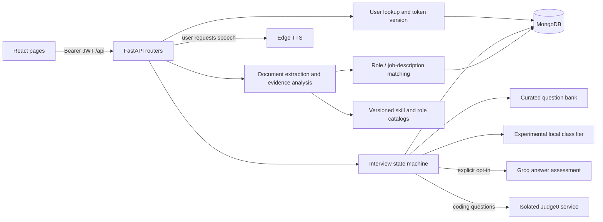

# Architecture and source audit — b3

## Supported system

The repository contained three incompatible interview generations. The default
runtime now uses React and FastAPI with MongoDB, preserving the upstream resume
intelligence implementation. Express and the modular interview-v2 prototype are
retained but unmounted. They must not be deployed as interchangeable backends.

## Execution and user journey

1. `main.jsx` mounts `App.jsx`, whose routes select public pages or
   `ProtectedRoute`. The guard checks token presence; the server remains the
   authority on token validity and ownership.
2. Login/signup calls `api/auth.js` → `/api/auth/*`. The client adapts FastAPI's
   `access_token` response and stores it under `interviewspar_token` in localStorage.
3. Account upload sends multipart `file`, Bearer authorization, and
   `X-Data-Consent: true`. Middleware bounds request size, then the resume router
   extracts and analyzes the document locally, stores it, and updates the profile.
4. Resume Intelligence requests an existing analysis or creates a role/JD match.
   The assessment service combines the user's latest resume, catalog/rubric data,
   deterministic evidence scoring, and recommendations, then persists an assessment.
5. Start Interview requests available domains and creates a session with explicit
   storage consent and optional AI consent. The server selects questions and saves
   the entire owned state document before returning the current question.
6. Interview Page sends question ID, session revision, unique request ID, answer,
   code/language where relevant, skip flag, and elapsed milliseconds. The server
   checks ownership and state, evaluates the recorded answer, advances once with
   a MongoDB compare-and-set, and returns the new state.
7. Practice mode displays feedback after each answer. Assessment mode postpones
   its display in the UI; it is a practice presentation mode, not a secure exam.
8. Finishing early or answering the final reflection creates a completed state.
   The report is computed from stored answers; unanswered/skipped entries do not
   become invented zero correctness scores. Dashboard lists up to 100 owned session summaries without downloading transcripts.
9. Users can delete an interview and its answers, or delete resumes and associated
   assessments. Existing interview prompts may contain resume facts and require
   separate session deletion. Database backups require an operator retention policy.

## Interview rounds and module communication

`app/routes/interview_flow.py` calls `app/interview_flow.py`, `app/safe_execution.py`,
`app/routes/auth.py`, and the shared database dependency. State lives in MongoDB,
not in a process-local session manager.

| Round | Current behavior |
| --- | --- |
| Screening | Two goals/experience questions |
| Calibration | Two domain questions; HR track uses HR calibration |
| HR | Ownership question plus a question from an actual parsed project/skill, or a generic learning question |
| Technical | Three domain prompts for technical track; observed round ability adjusts prompt depth |
| Coding | One curated Two Sum problem for eligible technical domains; excluded for HR, Product Management, and System Design |
| Behavioral | Team disagreement and learning from a mistake |
| Reflection | What to improve and practice next |

Technical interviews usually contain 13 questions; HR interviews contain 9.
Ability uses an exponential update, not a validated psychometric scale. Technical
ability requires evaluated correctness; behavioral practice uses text structure cues. The experience field is stored as context; it does
not currently select an experience-specific question bank. The bank is finite,
so repeated interviews can repeat questions.

Evaluation separates communication evidence (word count, examples, reasoning,
outcomes, filler observations) from technical correctness. Groq may assess
calibration/technical answers only after session opt-in; otherwise correctness
stays null. Judge0 correctness comes from server-side test cases. ML coaching
labels do not decide hiring eligibility or certification.

## Folder and important-file map

| Folder / files | Responsibility and status |
| --- | --- |
| `README.md`, `TODO.md`, `architecture.md` | Current setup, repair tracking, architecture/status |
| `docs/API.md`, `docs/DEPLOYMENT.md` | Canonical API and deployment reference |
| `docs/RESUME_INTELLIGENCE_IMPLEMENTATION_PLAN.md` | Detailed upstream design, evidence policy, phase records, and future roadmap |
| `PRD (1).md`, `rules.md`, `design.md` | Product requirements, constraints, visual direction; includes historical/aspirational features |
| `flow.md`, `Question_pipline_for_interview.md`, `steps.md`, `task.md` | Earlier workflows, proposed question pipeline, build sequence, and team history |
| `DEMO_GUIDE.md`, `TEST_SCRIPT.md`, `REPORT_TEMPLATE.md` | Historical prototype demo/testing/report material; superseded status examples |
| `.env.example`, `backend/.env.example`, `.gitignore` | Separate legacy/canonical configuration templates and private/generated-file exclusions |
| `.github/workflows/ci.yml` | Backend/ML tests and frontend test/build/lint workflow |
| `deploy/nginx.conf.example`, `Dockerfile`, `.dockerignore` | Example static/API ingress and isolated API image build context |
| `frontend/package.json`, `package-lock.json` | React, router, browser-model legacy dependencies; Vite/Tailwind/Oxlint tools and npm lock |
| `frontend/vite.config.js`, `tailwind.config.js`, `index.html` | Development proxy, CSS tooling, SPA shell |
| `frontend/src/main.jsx`, `App.jsx`, `index.css` | App bootstrap, actual route table, shared styles |
| `frontend/src/api/auth.js`, `api/tts.js` | Supported API client, normalized errors, consent header, authorization, cancellable TTS request |
| `frontend/src/pages/Login.jsx`, `Signup.jsx` | Authentication forms |
| `pages/AccountManagement.jsx` | Profile/password editing, consented resume upload, resume deletion |
| `pages/Dashboard.jsx` | Profile summary, owned session list, report/resume navigation |
| `pages/ResumeIntelligence.jsx`, `utils/resumeIntelligence.js` | Role/JD analysis, evidence/gaps/recommendations, null-score semantics, input/error formatting |
| `pages/StartInterviewPage.jsx`, `InterviewType.jsx`, `PracticeTracksPage.jsx` | Track/domain selection and consented start |
| `pages/InterviewPage.jsx` | Current question state, answer/retry/skip/finish, microphone input, code editor, practice feedback |
| `pages/InterviewReportPage.jsx`, `InterviewComplete.jsx` | Evidence report, print/PDF, session deletion; old completion URL adapter |
| `pages/Home.jsx`, `FeaturesPage.jsx`, `StudentGuidePage.jsx`, `ResourcesPage.jsx` | Public explanation, preparation guidance, generated Markdown study notes |
| `pages/SubscriptionPage.jsx`, `ContactPage.jsx` | Current free access/planned team features and real GitHub support link |
| `components/ProtectedRoute.jsx`, `DashboardNavbar.jsx`, `Navbar.jsx` | Token presence guard and navigation/logout |
| `components/Hero.jsx`, `Features.jsx`, `FeatureCard.jsx`, `TrustedCompanies.jsx`, `DashboardHero.jsx`, `ProfileCard.jsx` | Presentational sections/cards; usage claims corrected where reviewed |
| `components/interview/CodeEditor.jsx` | Current JS/Python editor and owned isolated-code-run request |
| `utils/naturalSpeech.js`, `utils/dictation.js` | Saved voice preferences, abortable playback, one-shot fallback, and invalidated dictation callbacks |
| `src/api.js`, `AuthContext.jsx` | Old Express client/auth context; not mounted by `main.jsx` |
| `pages/Interview.jsx`, `components/SessionView.jsx`, `AuthPage.jsx`, `Home.jsx`, `Dashboard.jsx` | Earlier UI generations, outside the current route tree |
| `components/interview/{HRRound,TechnicalRound,InterviewLayout,ProgressIndicator,ValidationToast,index}` | Experimental v2 UI contracts; not the current interview page |
| `components/{AdminPanel,CompanyPortal,DeveloperPortal,Marketplace,CollectView}.jsx` | Legacy administration/marketplace/data-collection prototype interfaces |
| `components/{FaceDetection,CameraView,IntegrityMonitor,InterviewAnalytics}.jsx`, `lib/faceLogic.js` | Legacy camera/integrity code; unsupported pixel heuristic and frame uploads disabled |
| `components/{VoiceControls,VoicePanel,HumanAvatar,InterviewerAvatar}.jsx`, `hooks/useSpeech.js`, `hooks/useWebcam.js` | Earlier voice/avatar/media helpers |
| `frontend/public/models/` | Vendored browser face/body/hand model manifests and binary assets; not trained or used by the canonical interview |
| `frontend/tests/` | Resume score/validation utilities and actual API-client contract tests |
| `backend/main.py` | FastAPI startup, canonical router mounting, rate limits, consent guard, generic DB failures, response headers |
| `backend/app/database.py` | Mongo client, explicit environment lookup, connectivity check, indexes, shutdown |
| `backend/app/auth.py`, `routes/auth.py`, `schemas.py` | Bcrypt/JWT primitives, user lookup/version revocation, auth/profile/password schemas; schemas also retain old route models |
| `backend/app/body_limit.py` | ASGI request-byte limit, including chunked uploads before multipart parsing |
| `backend/app/interview_flow.py`, `routes/interview_flow.py` | Curated question selection, rubric/report logic, owned versioned session lifecycle |
| `backend/data/interview_bank.json` | Canonical question domains/coding problems/test cases; reference solutions are excluded |
| `backend/app/routes/code.py`, `safe_execution.py` | Ownership/current-question checks and bounded Judge0 execution; no host execution |
| `backend/app/ml_service.py`, `fluency.py` | ML adapter and local textual fluency observations |
| `backend/app/routes/tts.py`, `tts.py` | Authenticated bounded synthesis, timeout, no persistent audio cache |
| `backend/app/routes/resume.py`, `resume_assessment.py` | Upload/latest/analysis/delete and match/history endpoints |
| `backend/app/resume_intelligence/parser.py`, `schemas.py` | PDF/DOCX validation/extraction, section/evidence extraction, typed versioned analysis |
| `resume_intelligence/normalization.py`, `catalog.py` | Alias disambiguation and validated skill/role/source/rubric loading |
| `resume_intelligence/job_description.py`, `assessment_engine.py` | JD requirement parsing and evidence/coverage formulas |
| `resume_intelligence/assessment_service.py`, `assessment_schemas.py`, `assessment_errors.py` | Owned persistence/retrieval, response contracts, domain errors |
| `resume_intelligence/recommendation_engine.py` | Deterministic skill/evidence/resume improvement suggestions |
| `resume_intelligence/job_market.py`, `job_market_schemas.py`, `rubric_builder.py` | Posting normalization, deduplication, evidence aggregation, provisional rubric generation |
| `resume_intelligence/import_catalog.py`, `ingest_job_market.py` | Operator CLIs for catalog/authorized evidence import; dry-run options; database name aligned with API |
| `backend/data/resume_intelligence/` | Versioned skills, roles, source registry, thresholds, five provisional role rubrics |
| `backend/app/api/`, `app/lib/interview/` | Unmounted v2: session manager, answer processor, validation, HR/technical rounds, question schema/challenges, provider-backed code evaluator |
| `backend/app/routes/{interview,sessions,questions,answers,reports,feedback,integrity,video}.py` | Unmounted prior conversational/modular APIs; incompatible with canonical state |
| `backend/app/adaptive.py`, `verification.py` | Prior ability and verification helpers; fabricated-success fallbacks removed |
| `backend/server.js`, `middleware/auth.js`, `routes/*.js` | Express legacy service, disabled unless explicitly enabled; auth/ownership fixes retained |
| `backend/services/{auth,store,sessions}.js` | Legacy file-backed accounts, runtime JSON, in-memory and archived sessions |
| `services/{llm,prompts,adaptive,classifierClient,featureExtractor,similarity,codeRunner}.js` | Legacy LLM/adaptive/ML/code helpers; feature parity and isolated execution retained |
| `backend/data/calibration.js`, `codingProblems.js` | Earlier JS domain/problem banks used to seed canonical source data |
| `backend/test_harness.js`, `test_harness.mjs` | Historical Express smoke harnesses; not canonical tests |
| `backend/tests/` | Resume parser/catalog/normalization/import/market/rubric/assessment suites and canonical HTTP/provider/body-limit regressions |
| `backend/requirements.txt`, `package.json`, `package-lock.json` | Python runtime/test dependencies and optional legacy Node dependencies |
| `ml/feature_extractor.py`, `infer.py` | Numeric feature contract, schema/hash checks, model inference and honest heuristic fallback |
| `ml/generate_synthetic.py`, `train_classifier.py`, `evaluate.py`, `test_features.py` | Synthetic bootstrap, split-aware model selection, shared evaluation entrypoint, parity tests |
| `ml/data/`, `ml/models/meta.json` | Labeled/synthetic source CSVs and provenance/evaluation metadata; trained pickle remains ignored |
| `blockchain/contracts/Certificate.sol` | Experimental issuer-only certificate records, score/session bounds, duplicate prevention |
| `blockchain/hardhat.config.js`, `scripts/deploy.js`, `package.json` | CommonJS Hardhat setup and test-network-only deployment script; no application integration |

Package `__init__.py` and index modules establish imports/exports. Dependency trees,
virtual environments, caches, `.git`, logs, runtime personal data, build outputs,
and binary model contents are excluded from source inspection. Model manifests
are configuration; binary weights are identified assets, not verified training data.

## Database architecture

MongoDB is the only database used by the supported app. API dependencies share one
client, with startup connectivity checks. No PostgreSQL `DATABASE_URL` is used.

| Collection | Main fields, ownership, and indexes |
| --- | --- |
| `users` | ObjectId, normalized unique email, name, bcrypt hash, token_version, resume pointer, profile fields |
| `resumes` | user_id string, raw_text, parsed_data, summary, structured analysis and schema/parser/catalog versions; user_id + descending _id |
| `interview_sessions` | user_id, engine_version=2, consent, domain/persona/mode, questions, answers with evaluations/request IDs, index, version, ability, timestamps/status; user_id + engine_version + descending _id |
| `resume_assessments` | assessment_id, user_id, resume/catalog/rubric identity, mode, findings, scores, recommendations, creation time; unique assessment_id and user/mode/role history indexes |
| `skill_taxonomy`, `role_taxonomy`, `source_registry`, `role_rubrics` | Optional imported operator datasets. Runtime scoring currently loads the versioned file catalog; importing a generated rubric does not publish it automatically |
| `job_postings`, `job_market_ingestion_runs`, `unknown_job_skills` | Operator-imported normalized evidence, source/version/dedup records and unmatched terms |
| `sessions`, `questions`, `answers`, `reports`, `feedback`, `integrity_logs`, `video_sessions` | Historical collections; old API data is preserved but not exposed by the canonical route set |

Question and answer arrays are embedded because an interview has a bounded set
of rounds. Revision filters prevent simultaneous answers from advancing twice.
Repeated request IDs return current state. Assessment identity hashes include
user/resume and scoring inputs; identical requests reuse the saved assessment.
MongoDB has no relational foreign keys. Resume/profile writes have a compensating
delete on failure, not a multi-document transaction. Account-wide erasure and
backup erasure are not implemented.

## Resume intelligence and ML

PDF extraction uses pdfplumber; DOCX uses python-docx with file/signature/archive
checks. Empty, malformed, macro-enabled, over-limit, and scanned-only inputs are
rejected. OCR is absent. Structured evidence tracks source spans and confidence;
contact values are removed from analysis, but owned raw resume text is retained
with consent. Parsing is local and does not send the resume to an LLM.

Catalog aliases distinguish ambiguous short language names and avoid substring
matches/double counting. Five role rubrics cover SDE, frontend, backend, data
analysis, and ML engineering. They are provisional and have no validated market
weights, so aggregate role scores are unavailable. JD matching measures textual
requirement coverage; it is not an ATS score, employability score, or hiring probability.
Unknown terms remain unknown. Recommendations derive from actual gaps/evidence.

The interview classifier consumes nine numeric/text-derived features. Training
selects on validation data and reports a separate test partition. Most rows are
synthetic, so perfect bootstrap accuracy is not real-world validation. A missing
model produces a labeled heuristic, not a fabricated confidence. See `ml/README.md`.

## Authentication and authorization

Signup hashes passwords with bcrypt (minimum 8 characters, maximum 72 UTF-8 bytes).
Login returns an HS256 JWT valid for 24 hours. Every protected route verifies the
signature/expiry, user ObjectId, user existence, and token version. Password change
and logout increment the stored version to invalidate old tokens; password change
returns a fresh token. Logout currently signs out all devices.

Owned reads/writes include user IDs and return 404 for another user's object.
The new app has no public role escalation, admin endpoints, or socket rooms.
The legacy server enforces auth and restricted administrative routes but remains
outside the supported product. CORS allows configured origins; it is not a substitute
for authorization. LocalStorage bearer tokens remain vulnerable to same-origin XSS.
Email verification, password reset, MFA, refresh sessions, and account deletion are
not implemented. Process-local per-IP limits need production ingress enforcement.

## Repair status and residual risks

Repaired: backend/proxy mismatch; broken auth/profile/password contracts; stale and
duplicate interview advancement; missing round/report/history/deletion contracts;
unsafe host code execution; missing upload consent/size boundaries; fabricated
resume/verification outputs; ML feature/zero/unit/provenance bugs; unsupported
camera inference and frame upload; legacy ownership/privacy gaps; fake payment,
contact, and download success claims; issuer-unrestricted certificate minting.

Still limited: finite question coverage and one coding problem in the default
flow; no experience-specific bank; rule-based communication feedback; externally
judged correctness needs validation; provisional market rubrics; no OCR; synthetic
ML training; unsupported legacy UI lint warnings; no real-time interview rooms or
production billing; no certificate issuance path or fairness-certified anti-cheat.

Verification covers synthetic HTTP/database doubles, pure logic, frontend client
contracts, build, lint, and JS syntax. Live MongoDB behavior under load, Groq/Judge0/
TTS availability, browser media/accessibility, Docker deployment, and Solidity
compilation/testnet transactions require separate acceptance. See `TODO.md` for
actual results; none of these external checks are implied by unit-test success.

Follow-up corrections and current verification counts are recorded in [docs/QUALITY_REVIEW.md](docs/QUALITY_REVIEW.md). Historical stored evaluations have not been retroactively regraded.
